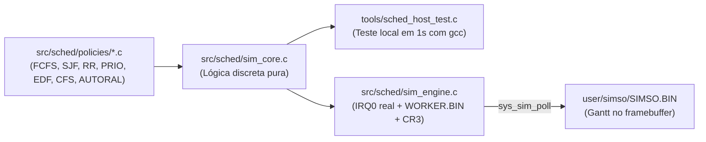

# 04 — Processos, Escalonador e Simulador (`feat/simso`)

## Tabela de Autoria deste Módulo

| Arquivo | Origem | Resumo |
| :--- | :--- | :--- |
| `src/sched/proc.{h,c}`, `proc_util.h` | **AI-assisted** | Estrutura `struct proc`, hash table por PID, criação/término e handler `proc_int` (base do autor; IA adicionou `proc_create_sized`, `g_timer_ticks`, `kb_drain` no exit e isolamento via `arch_proc.h`). |
| `src/sched/sched.c` | **AI-assisted** | Round-Robin 0..63 pulando `PROC_DEAD`/`PROC_BLOCK` + delegação para `sim_engine_tick()` quando o simulador está ativo. |
| `src/sched/contract/sim.h` | **AI-generated** (`39183c3`) | Contrato congelado único (~70 linhas): `struct task`, `struct sim`, 7 funções `pick_*()`, `sim_init/step/notify_exit` e `render_gantt()`. |
| `src/sched/sim_core.c` | **AI-generated** (`39183c3`) | Motor discreto puro (chegadas, sobrecarga de contexto, estouro de deadline, métricas e modo autônomo `burst == 0`) compartilhado entre kernel e `tools/`. |
| `src/sched/sim_engine.{h,c}` | **AI-generated** (`39183c3`) | Ponte entre o `sim_core` e processos reais `WORKER.BIN` escalonados pelo IRQ0 com troca real de CR3. |
| `src/sched/policies/*.c` | **AI-generated** (`39183c3`) | 7 arquivos independentes (`fcfs.c`, `sjf.c`, `rr.c` pronta, `prio.c`, `edf.c`, `cfs.c`, `autoral.c`) — 1 função `pick_*()` por arquivo. |

---

## 1. Ciclo de Vida de Processos (`src/sched/proc.c`)

Cada processo é representado por `struct proc` (`src/sched/proc.h`):
- `ctx` (`struct arch_proc`): registradores salvos + `cr3` (tabela PML4 própria).
- `stack_base`: endereço virtual da pilha de usuário.
- `state`: `PROC_DEAD`, `PROC_EXEC`, `PROC_BLOCK`, `PROC_READY`.
- `id`: PID (`utiny`, armazenado em `proc_hash_table` via `proc_util.h`).

### Criação (`proc_create_sized` / `proc_create`)
1. Salva o espaço de endereços atual (`arch_addr_space_save()` — registrador `cr3`).
2. Cria uma nova PML4 (`arch_proc_init(&proc->ctx)`) e aloca a pilha de usuário (`usr_kmalloc(stack_size)`).
3. Mapeia `code_size + bss_size` bytes a partir do endereço fixo **`0x00400000`**, copia o binário flat e prepara o frame inicial de `iretq` (`arch_proc_setup_frame`).
   - `proc_create()` chama `proc_create_sized(..., 8 MiB, ...)` (necessário para o `.bss` do DOOM).
   - O `sim_engine` chama `proc_create_sized(..., 4 KiB, 4 KiB)` para os `WORKER.BIN` leves.
4. Restaura o espaço de endereços do chamador (`arch_addr_space_restore()`) e insere o processo na tabela.

### Preempção no Timer (`proc_int`)
Executada a cada **10 ms** (IRQ0 / PIT 100 Hz):
1. Incrementa `g_timer_ticks++` (base de tempo para `sys_ticks_ms()`).
2. Se `current_proc` estava em Ring 3 (`arch_proc_save_user_ctx`), salva `intf` em `current_proc->ctx` e marca `PROC_EXEC -> PROC_READY`.
3. Chama `next = proc_sched()`.
4. Marca `next->state = PROC_EXEC` e atualiza `current_proc = next`.
5. Retorna `current_proc` para `int_handler.S`, que carrega `next->ctx.cr3` e executa `iretq`.

### Encerramento (`proc_exit`)
Marca `current_proc->state = PROC_DEAD`, libera `stack_base`, e se a shell (PID 0) estava bloqueada esperando o filho (`PROC_BLOCK`), executa `kb_drain()` e acorda a shell (`PROC_READY`).

---

## 2. Escalonador Normal (`src/sched/sched.c`)

```c
struct proc *proc_sched()
{
    if (sim_engine_is_active())
        return sim_engine_tick();
    // Round-Robin sobre PIDs 0..63 ignorando PROC_DEAD e PROC_BLOCK
}
```

Quando nenhuma simulação do trabalho está ativa, `proc_sched()` faz Round-Robin simples entre `SHELL.BIN` e qualquer processo filho (ex.: `DOOM.BIN` ou `SIMSO.BIN`).

---

## 3. Arquitetura do Simulador Plugável (`feat/simso`) *(AI-generated)*

O simulador foi dividido em **3 camadas** para que os colegas de C++ e Web Dev trabalhem em paralelo sem precisar do QEMU:



### Contrato Único (`src/sched/contract/sim.h`)
Cada algoritmo é apenas **1 função C11 freestanding** em seu próprio arquivo `src/sched/policies/<alg>.c` (sem `malloc`, sem `stdio`, sem floats no kernel):
```c
int pick_fcfs(struct task *tasks, uint32_t task_count, int current_idx, uint32_t now, uint32_t quantum);
```
Retorna o índice `0..task_count-1` da tarefa que roda no tick `now`, ou `-1` se a CPU ficar ociosa. O `struct proc` embute `struct task sched;` diretamente, e o `sim_core.c` suporta tanto **burst fixo** (`burst > 0`, para o *Caso Base*) quanto **processos reais autônomos** (`burst == 0`, que rodam até chamar `sys_exit()` → `sim_notify_exit()`).

### Motor Discreto (`src/sched/sim_core.c`)
A cada chamada a `sim_core_step(&sim, &active_task)`:
1. Admite tarefas com `arrival <= now` (`PENDING -> READY` + `on_arrive`).
2. Se `overhead_left > 0`, consome 1 tick de `SIM_TICK_OVERHEAD` (vermelho) e avança `now`.
3. Chama `policy->pick_next()`. Se não houver tarefa pronta, registra `SIM_TICK_IDLE`.
4. Se `next != last_idx` (troca entre dois processos):
   - Incrementa `context_switches++` (e `preemptions++` se o anterior ainda não havia terminado).
   - Se `cfg.ctx_overhead > 0`, entra em estado de sobrecarga por `ctx_overhead` ticks antes de despachar `next`.
5. Executa 1 tick de `current_idx`: registra `SIM_TICK_DEADLINE_MISS` (cinza) se `now >= deadline`, senão `SIM_TICK_EXEC` (verde); decrementa `remaining`; ao chegar em 0, calcula `finish`, `turnaround`, `wait_time` e `deadline_ok`.

### Ponte com Processos Reais (`src/sched/sim_engine.c`)
- **Por que não bloquear com `sti; hlt` dentro de uma syscall?**
  Porque `proc_int` só salva `intf` quando a interrupção vem de Ring 3 (`(cs & 3) == 3`). Bloquear com `sti; hlt` em Ring 0 faria o `iretq` retornar para um frame antigo.
- **Solução limpa (não-bloqueante):**
  1. `SIMSO.BIN` chama `sys_sim_start(&cfg)` → o kernel garante um pool de `N` processos reais `WORKER.BIN` (criados via `proc_create_sized`, estacionados em `PROC_BLOCK`), inicializa `sim_core` e ativa `s_state = SIM_STATE_RUNNING`, retornando `0` para Ring 3.
  2. `SIMSO.BIN` entra em `while (sys_sim_poll(&trace) == 0) { pause; }` em Ring 3.
  3. A cada IRQ0 real, `proc_int` salva o contexto Ring 3 de `SIMSO.BIN` com segurança e chama `sim_engine_tick()`:
     - Em ticks de execução, retorna o `struct proc *` real do `WORKER.BIN` escolhido → a CPU troca `cr3` e executa `WORKER.BIN` em Ring 3!
     - Em ticks ociosos/overhead ou ao terminar (`SIM_STATE_DONE`), retorna `s_owner` (`SIMSO.BIN`).
  4. `sys_sim_poll(&trace)` copia `struct sim_trace` para o espaço de usuário e retorna `1`.

> **Pontos-chave para estudar (modificações de IA):**
> - O fluxo `sys_sim_start` → IRQ0 (`sim_engine_tick`) → troca real de CR3 para `WORKER.BIN` → `sys_sim_poll`.
> - Por que `sim_core.c` é idêntico no kernel e no `tools/sched_host_test.c`.
> - Como `rr.c` usa `task->user_data` como timestamp de fila FIFO sem precisar de `malloc`.
