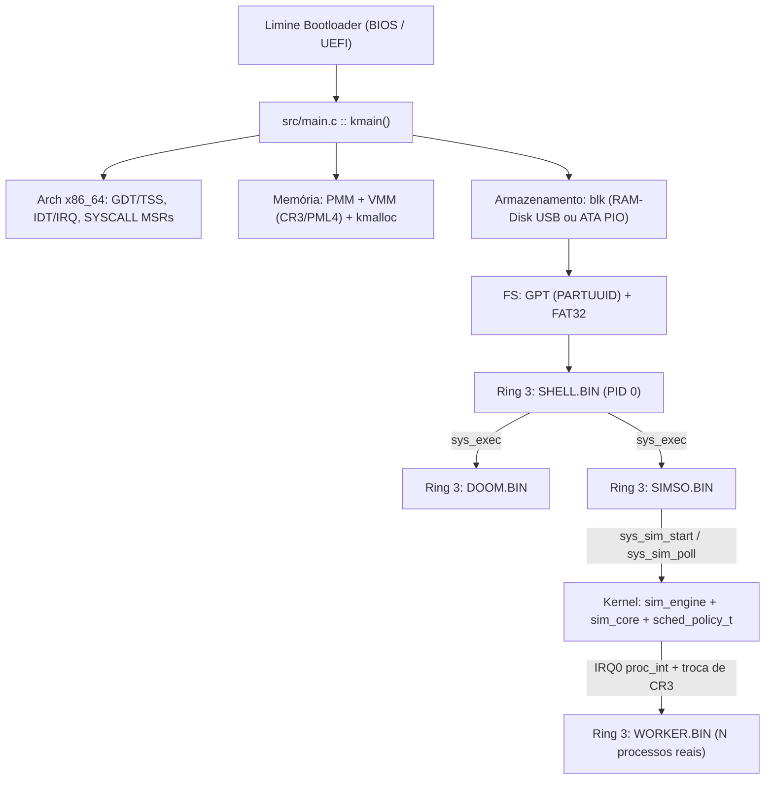

# Documentação Completa do Kernel Zanux

Documentação técnica de toda a arquitetura do **Zanux** (kernel freestanding `x86_64` em C11 + Assembly GAS + Rust, inicializado via Limine), incluindo separação explícita entre o que foi escrito diretamente pelo autor (**Paulo**) e o que foi criado ou modificado com assistência de IA (**AI-assisted** / **AI-generated**).

---

## Índice

1. **[Mapa de Autoria e Roteiro de Estudo (Arguição)](./ATTRIBUTION.md)**
   - Tabela arquivo-por-arquivo (`Autor (Paulo)`, `AI-assisted`, `AI-generated`) com hashes de commit.
   - Checklist objetivo do que estudar antes da apresentação.
2. **[01 — Boot, Arquitetura x86_64, GDT, IDT e Syscall Entry](./01_boot_e_arch.md)**
   - Limine, `kmain()`, GDT/TSS, IDT/PIC/IRQ, `int_handler.S`, `arch_proc.h` e MSRs de `SYSCALL`/`SYSRET`.
3. **[02 — Gerenciamento de Memória (PMM, VMM e Alocadores)](./02_memoria.md)**
   - PMM, paginação de 4 níveis (PML4/CR3, HHDM), `kmalloc`, `usr_kmalloc`, `arena` e `util/memory`.
4. **[03 — Drivers (Rust + C), RAM-Disk USB, GPT e FAT32](./03_drivers_e_fs.md)**
   - PIT 100 Hz, teclado PS/2 (`Ctrl+L` + scancodes brutos), UART COM1, ATA PIO, abstração `blk` (RAM-disk para pendrive USB), framebuffer Limine, GPT e leitor FAT32.
5. **[04 — Processos, Escalonador e Simulador (`feat/simso`)](./04_processos_e_sched.md)**
   - `struct proc` (com `struct task sched` e `fxsave` SSE/FPU), `proc_create_sized`, preempção no IRQ0 (`proc_int`), Round-Robin (`sched.c`) e o simulador (`contract/sim.h`, `sim_core.c`, `sim_engine`, `policies/`).
6. **[05 — Syscalls (0..14), User Space (Ring 3), `libzanuxc` e Ferramentas de Host](./05_syscalls_e_userspace.md)**
   - Tabela completa de syscalls (incluindo SB16 `SYS_AUDIO_WRITE`), ABI Ring 3 em `0x400000`, `user/libc/` (`libzanuxc.a` + `zgfx.h`), `SHELL.BIN`, `DOOM.BIN`, `WORKER.BIN`, `SIMSO.BIN` e `tools/`.
7. **[06 — Guia Prático para os Colegas (Algoritmos + UI Nativa)](./06_guia_dos_colegas.md)**
   - Onboarding direto para os colegas de C++ e Web Dev: onde mexer, regras freestanding, dicas por algoritmo e comandos de teste local sem QEMU.
8. **[07 — Justificativa Linha a Linha de `src/sched/contract/`](./07_justificativa_contrato.md)**
   - Explicação de cada constante, enum, campo de struct e função dos headers congelados do contrato para revisão antes de entregar aos colegas.
9. **[08 — Divisão do Grupo e Cronograma (Entrega: 04/Dez)](./08_divisao_do_grupo.md)**
   - Pastas individuais por integrante: **[Paulo](./equipe/paulo/README.md)** · **[Dante](./equipe/dante/README.md)** · **[Petra](./equipe/petra/README.md)** · **[João Vitor](./equipe/joao_vitor/README.md)**.

---

## Visão Geral da Arquitetura

---

## Como o Build Funciona (`GNUmakefile`)

| Artefato | Comando | Descrição |
| :--- | :--- | :--- |
| `bin/kernel` | `make kernel` | Compila `src/**/*.c`, `src/**/*.S` e `src/lib.rs` (Rust `x86_64-unknown-none`) e linka com `boot/linker-scripts/x86_64.lds`. |
| `user/shell/SHELL.BIN` | `make -C user/shell` | Binário flat Ring 3 carregado em `0x400000`. |
| `user/worker/WORKER.BIN` | `make -C user/worker` | Processo worker CPU-bound Ring 3 para o escalonador. |
| `user/simso/SIMSO.BIN` | `make -C user/simso` | Frontend gráfico Ring 3 do simulador de escalonamento (`sys_fb_blit`). |
| `disk.img` | `make disk.img` | Imagem GPT pura + partição FAT32 (`PARTUUID=11223344-...`). |
| `template.iso` | `make template.iso` | ISO híbrida BIOS + UEFI contendo `bin/kernel` e `disk.img` como módulo Limine — grava direto em pendrive com `dd`. |
